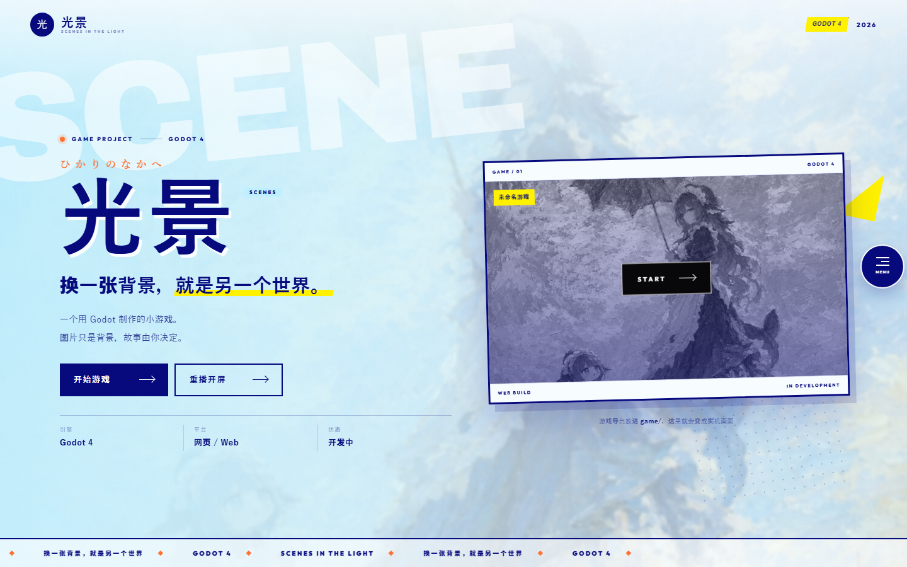
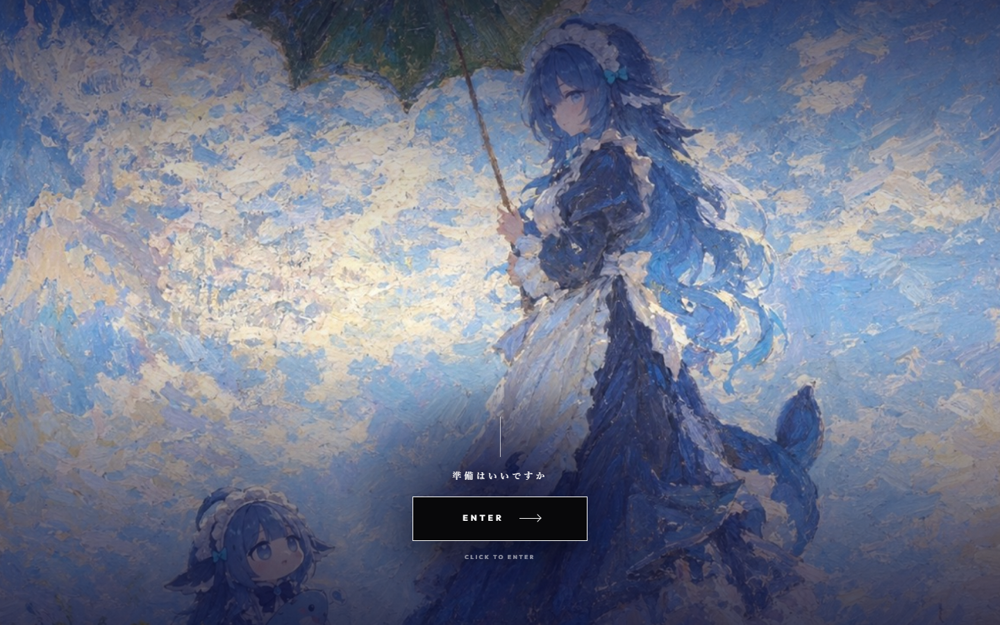
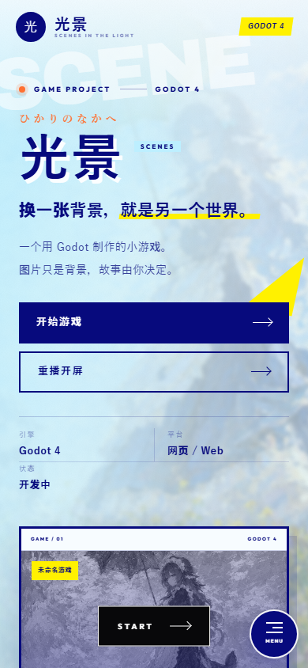
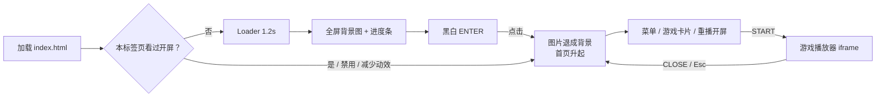

# 光景 — SCENES IN THE LIGHT

> 一个为 Godot 小游戏制作的单页官网 / 视觉原型：开屏先展示一张整图，黑白 `ENTER` 之后，图片原地退成页面背景，进入游戏入口。




<details>
<summary>开屏与移动端预览</summary>





</details>

## 项目简介

这是一个纯静态的单页游戏官网，用来展示一个用 Godot 4 制作的小游戏。它把“开屏动画、背景图、游戏入口、全屏菜单、游戏播放器”组合成一套完整的视觉体验。

页面本身不依赖框架、不需要构建，也没有后端；游戏通过 `game/` 目录以 Web 导出的形式嵌入到 iframe 中。当前 `game/` 为空，所以点击 `START` 会显示“游戏还没有放进来”的引导页，这是预期状态。

核心关键词：

- 日系编辑设计 / 波普印刷感
- 海军蓝、天空蓝、荧光黄、橙色的撞色
- 超大 `SCENE` 水印、网格点、斜切色块、硬阴影
- 开屏整图 → 图片退成背景 → 单页内容
- 全屏菜单、游戏卡片、16:9 游戏播放器
- 无构建、无追踪、无第三方 API

## 技术栈

| 项目 | 说明 |
| --- | --- |
| 页面结构 | `index.html` 单页 |
| 样式 | 原生 CSS（自定义属性、Grid / Flex、动画、响应式） |
| 脚本 | 原生 JavaScript（ES6+，IIFE 封装） |
| 字体 | 本地 `woff2`：Outfit、Archivo Black |
| 游戏 | Godot 4 Web 导出，通过 iframe 嵌入 |
| 构建 | 无 |
| 后端 | 无 |
| 存储 | `sessionStorage`，仅记录开屏是否看过 |

## 功能特性

- [x] 三幕开屏：Loader → 全屏背景图 → 黑白 `ENTER`
- [x] 进入后背景图变暗、模糊，退成页面背景
- [x] 同一标签页只自动播放一次开屏
- [x] `SKIP` 跳到 `ENTER`，`Esc` 控制开屏与菜单
- [x] 首页 Hero、游戏卡片、跑马灯、留白区、页脚
- [x] 全屏菜单，支持焦点管理与滚动锁定
- [x] 游戏播放器：检测 `game/index.html`，缺失时显示导出指引
- [x] 游戏 iframe 关闭后销毁，避免后台继续运行
- [x] 背景图清单自动生成，支持多张图片
- [x] 响应式布局：桌面 / 平板 / 手机 / 矮屏桌面
- [x] `prefers-reduced-motion` 下跳过开屏动画
- [x] 键盘可访问：跳转链接、焦点圈定、`Esc` 关闭、焦点返回
- [ ] 游戏本体（当前 `game/` 为空）
- [ ] 开屏多图轮播（当前只使用第 1 张）
- [ ] Open Graph / Twitter Card 等分享元信息

## 页面与交互流程



## 开屏流程

| 阶段 | 时间 | 画面 |
| --- | --- | --- |
| Loader | 0 – 1.2s | 三色斜带 + `SCENE` + `NOW LOADING` |
| 图片幕 | 1.2 – 4.0s | 整张背景图全屏，缓慢推近，底部进度条 |
| ENTER | 约 4.0s | 黑白 `ENTER` 按钮淡入，其余 UI 退场 |
| 进入 | 点击后 1.15s | 图片变暗、模糊，退成页面背景；首页内容升起 |

补充：

- 进度条 CSS 动画时长为 `4.2s`，比 `ENTER` 出现略长一点；如果调整开屏节奏，建议同步修改。
- `LOADER_HOLD`、`IMAGE_PLAY`、`ENTER_TIME` 位于 `assets/main.js` 顶部。
- 进度条时长位于 `assets/style.css` 的 `.opening.is-loaded .shot__bar i`。
- 右上角 `SKIP` 会直接跳到 `ENTER` 阶段。
- 开屏内按 `Tab` 会在可交互元素之间循环，焦点不会跑出弹层。
- 开屏期间按 `Esc`：如果 `ENTER` 还没出现，会先显示 `ENTER`；如果已经出现，则直接进入页面。

## 自动播放与 URL 参数

开屏是否自动播放由 `sessionStorage` 的 `scene-entered` 键控制：

| 情况 | 行为 |
| --- | --- |
| 首次访问（本标签页） | 自动播放开屏 |
| 已经进入过 | 直接显示页面 |
| `?opening=1` | 强制播放开屏 |
| `?noopening=1` | 关闭开屏 |
| `?opening=0` | 关闭开屏 |
| 系统开启“减少动态效果” | 直接显示页面 |

其他入口：

- 首页「重播开屏」
- 全屏菜单第 3 项「重播开屏」
- 页脚「重播开屏」

如果想重新测试自动播放，可以在浏览器控制台执行：

```js
sessionStorage.removeItem("scene-entered");
location.reload();
```

## 换背景图

背景图放在：

```text
印象派阳光下的鲸娘伙伴/
```

步骤：

1. 把 `jpg` / `jpeg` / `png` / `webp` / `gif` / `avif` 图片放进该文件夹。
2. 双击文件夹里的 `更新照片清单.bat`。
3. 回到网页按 `Ctrl + F5` 强制刷新。

规则：

- 图片按文件名排序，建议使用 `01.jpg`、`02.jpg`、`03.jpg` 这样的命名。
- 清单会自动写入 `assets/photos.js`，不需要手动维护。
- 当前 `main.js` 只使用 **第 1 张** 图片，作为开屏背景、页面背景和游戏卡封面。
- `放照片到这里.txt` 中提到“开屏最多显示前 4 张”，但当前版本还没有实现多图轮播。
- 如果没有图片，背景会使用蓝白渐变，游戏卡封面会隐藏。
- 文件夹可以改名，但改名后需要重新运行一次 `更新照片清单.bat`。
- 背景使用 `background-size: cover`，会铺满并裁边；如果希望完整显示，可以把 `style.css` 中 `.bg__media` 的 `cover` 改成 `contain`。

当前示例图片：

```text
印象派阳光下的鲸娘伙伴/01.jpg
```

## 接入 Godot 游戏

1. 在 Godot 4 中打开游戏项目。
2. 选择「项目 → 导出」，添加 **Web** 预设。
3. 导出到本项目的 `game/` 目录，入口文件名保持 `index.html`。
4. 确认目录结构类似：

```text
game/
├─ index.html
├─ index.js
├─ index.wasm
└─ index.pck
```

5. 通过 HTTP 打开网站，点击 `START`。

播放器逻辑：

- 点击 `START` 后，页面会先用 `HEAD` 请求检查 `game/index.html` 是否存在。
- 如果不存在，会显示“游戏还没有放进来”的导出指引，而不是白屏。
- 如果是通过 `file://` 直接打开页面，会提示需要用本地服务器。
- 如果存在，则创建 16:9 的 iframe（手机端为 4:3），并允许全屏、手柄、自动播放和剪贴板写入。
- 关闭播放器时会移除 iframe，避免游戏在后台继续运行。

> 如果 Godot Web 导出启用了多线程（Thread Support），服务器需要发送 `Cross-Origin-Opener-Policy` 和 `Cross-Origin-Embedder-Policy` 头。项目原版的 `server.mjs` 已处理这一点；使用 Python 的简单静态服务器时通常没有这两个头。

## 本地运行

### 只看页面

可以直接双击 `index.html`。页面本身可以正常显示，但游戏 iframe 不能通过 `file://` 加载。

### 推荐：本地静态服务器

在项目根目录运行：

```bash
python -m http.server 8000
```

然后访问：

```text
http://127.0.0.1:8000/
```

也可以使用：

```bash
npx serve -l 8000
```

如果目录中存在 `server.mjs` 和 `启动网站.bat`，可以直接双击 `启动网站.bat`，它会用 Node.js 启动服务器并自动打开浏览器。

当前副本未包含 `server.mjs` 和 `启动网站.bat`，可以使用上面的 Python / npx 方式替代。

如果 8000 端口被占用：

```bat
set PORT=8080 && node server.mjs
```

## 页面结构与自定义

| 想改什么 | 位置 |
| --- | --- |
| 浏览器标题 | `index.html` 的 `<title>` |
| 页面描述 | `index.html` 的 `<meta name="description">` |
| 站名 / 品牌 | `.mini-head__name`、`.nav__brand`、`.footer__logo` |
| 首页大标题 | `.hero__title`、`.hero__title-en` |
| 首页标语 | `.hero__tagline`、`.hero__lead` |
| 日文装饰文案 | `.hero__jp`、`.shot__jp`、`.gate__jp` |
| 游戏卡名称 | `.gamecard__chip`、`.gamecard__bar` |
| 游戏卡状态 | `GAME / 01`、`WEB BUILD`、`IN DEVELOPMENT` |
| 引擎 / 平台 / 状态 | `.hero__meta` |
| 留白区文案 | `.soon` |
| 页脚版权 | `.footer__copy` |
| 主色 / 辅助色 | `assets/style.css` 顶部 `:root` |
| 开屏节奏 | `assets/main.js` 的 `LOADER_HOLD`、`IMAGE_PLAY`、`ENTER_TIME` |
| 进度条时长 | `assets/style.css` 的 `.opening.is-loaded .shot__bar i` |
| 游戏播放器比例 | `.player__stage` 的 `aspect-ratio` |
| 背景裁切方式 | `.bg__media` 的 `background-size` |

配色变量：

```css
--navy: #070a7d;
--blue: #00a0e9;
--sky: #bdefff;
--sky-deep: #57d0fb;
--yellow: #fff100;
--orange: #ff7031;
--paper: #f7fcff;
```

字体：

- `Archivo Black`：英文展示标题
- `Outfit`：英文正文 / UI
- 日文部分使用系统字体：Yu Gothic / Hiragino / Noto Sans JP 等
- 中文部分使用系统默认无衬线字体

## 文件结构

```text
.
├─ index.html                 # 开屏、首页、菜单、播放器结构
├─ assets/
│  ├─ style.css               # 设计变量、开屏、首页、菜单、播放器、响应式
│  ├─ main.js                 # 开屏状态机、背景、菜单、游戏 iframe
│  ├─ photos.js               # 照片清单（由 bat 生成）
│  └─ fonts/
│     ├─ archivo-black-latin.woff2
│     └─ outfit-latin.woff2
├─ 印象派阳光下的鲸娘伙伴/
│  ├─ 01.jpg                  # 当前使用的背景图
│  ├─ 更新照片清单.bat
│  ├─ update-photos.ps1
│  └─ 放照片到这里.txt
├─ game/                      # 空目录；Godot Web 导出放这里
└─ preview/
   ├─ home.png
   ├─ opening.png
   └─ mobile.png
```

> 当前副本未包含 `server.mjs`、`启动网站.bat` 和 `game/放游戏到这里.txt`。前两个用于本地服务器，后一个是游戏目录说明；不影响页面本身运行。

## 响应式与可访问性

响应式断点：

- `1180px`：中等桌面
- `980px`：平板 / 小桌面，Hero 改为单列
- `640px`：手机，按钮变为整行，页脚单列
- `400px`：超窄屏
- `max-height: 760px`：矮屏桌面单独压缩间距

可访问性：

- 跳过导航链接 `跳到正文`
- `:focus-visible` 高对比虚线焦点
- 开屏弹层 `role="dialog"`、`aria-modal="true"`
- 开屏内 `Tab` 焦点圈定
- `Esc` 关闭菜单 / 播放器 / 开屏
- 关闭菜单和播放器后焦点返回触发元素
- 打开弹层时锁定 body 滚动，并补偿滚动条宽度
- `prefers-reduced-motion` 下跳过开屏、关闭主要动画
- `noscript` 下隐藏开屏，直接显示页面

预览图尺寸：

- 桌面：`1440 × 900`
- 手机：`390 × 844`

## 调试接口

浏览器控制台可以直接调用：

```js
window.SCENE.playOpening(); // 重播开屏
window.SCENE.enter();       // 直接进入页面
window.SCENE.openGame();    // 打开游戏播放器
window.SCENE.photos;        // 当前照片清单
```

## 当前状态与注意事项

- **`game/` 为空**：点击 `START` 会显示“游戏还没有放进来”的引导页，这是当前预期行为。
- **缺少本地服务器脚本**：当前副本没有 `server.mjs` 和 `启动网站.bat`，页面中的提示仍引用 `启动网站.bat`；可以使用 Python / npx 启动，或从原版目录复制这两个文件。
- **只有一张背景图**：`assets/photos.js` 当前只包含 `01.jpg`。
- **多图开屏尚未实现**：`放照片到这里.txt` 提到“开屏最多显示前 4 张”，但 `main.js` 目前只读取第一张。
- **开屏进度条与 ENTER 的时差**：`IMAGE_PLAY` 为 `2800ms`，`ENTER` 约在 4.0s 出现；CSS 进度条为 `4.2s`，两者略有差异。
- **占位文案**：`未命名游戏`、`2026`、`开发中` 等仍是占位内容。
- **没有根级 LICENSE**：代码和素材的复用 / 分发请先确认授权。

## 素材、字体与许可

> [!IMPORTANT]
> 仓库未附独立的素材授权文件。`印象派阳光下的鲸娘伙伴/` 中的插画、`preview/` 截图以及页面中使用的字体，版权归各自权利人所有。公开发布或商用前，请确认插画、字体和游戏素材的许可，或替换为有授权的素材。

- 字体：`Outfit`、`Archivo Black`，文件已本地化到 `assets/fonts/`；通常遵循各自字体许可（如 SIL OFL），具体以官方许可为准。
- 插画：`印象派阳光下的鲸娘伙伴/01.jpg`，仅作为示例背景图使用。
- 截图：`preview/` 下为页面预览截图。
- 仓库目前没有根级 `LICENSE` 文件；代码复用前请先联系仓库作者确认授权方式。

## 仓库

- GitHub：<https://github.com/Kaatou520/scene-web>
- 技术栈：HTML / CSS / JavaScript / Godot 4 Web
- 如果发现 bug 或有改进建议，欢迎提交 Issue。
